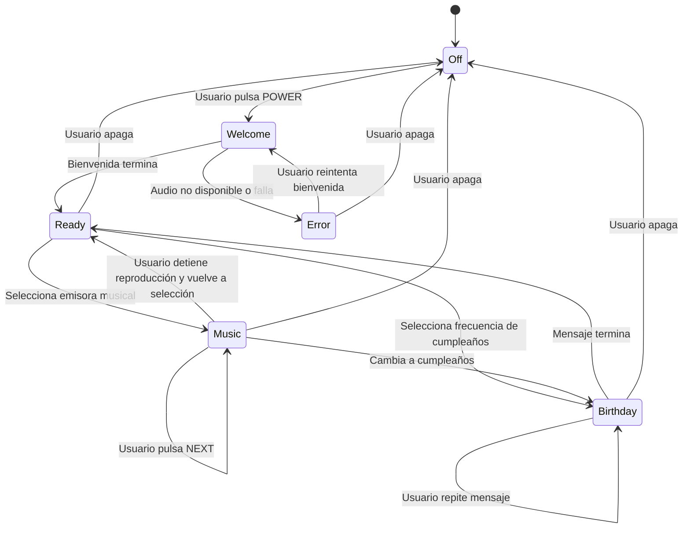

# Plan maestro de desarrollo --- Radio Retro Personalizada

> **Proyecto:** radio web interactiva inspirada en equipos de sonido
> para automóvil de principios de los años 2000\
> **Stack previsto:** React + Vite + JavaScript o TypeScript + CSS\
> **Tipo de producto:** experiencia web personal, reproductor de audio
> local y consola visual interactiva\
> **Estado del documento:** especificación funcional, visual, técnica,
> de calidad y de entrega\
> **Objetivo:** que un agente de desarrollo pueda implementar el
> proyecto por fases, validar cada fase y entregar una aplicación
> coherente, accesible, mantenible y fiel al concepto.

------------------------------------------------------------------------

## 0. Instrucciones principales para el agente de desarrollo

Este documento es la fuente de verdad del proyecto. Antes de escribir
código, el agente debe leerlo completo, inspeccionar el repositorio
existente y convertir las tareas en una lista de implementación
verificable.

### 0.1 Reglas de ejecución

1.  **No construir todo en un único componente.** Separar interfaz,
    estado del reproductor, datos de emisoras, utilidades de
    aleatoriedad y estilos.
2.  **No simular funcionalidad que no existe.** Todos los botones
    visibles deben ejecutar una acción real o estar claramente
    deshabilitados con una razón.
3.  **No sustituir los audios personales por música de muestra en
    producción.** Usar rutas y archivos de ejemplo solo durante el
    desarrollo y marcarlos claramente.
4.  **No permitir que las emisoras musicales se reproduzcan antes de
    finalizar la bienvenida.**
5.  **No iniciar audio audible al cargar la página sin interacción del
    usuario.** Los navegadores pueden bloquearlo. La solución de
    producto es mostrar la radio apagada y reproducir la bienvenida
    cuando la persona pulse el botón de encendido. Si existe una
    interacción previa válida y el navegador permite reproducir, el
    código debe seguir manejando el rechazo de reproducción
    correctamente.
6.  **La emisora de cumpleaños es especial:** reproduce únicamente el
    mensaje de felicitación. No debe entrar en la cola aleatoria de
    música.
7.  **La aleatoriedad debe evitar repeticiones hasta completar el ciclo
    de canciones de cada emisora.**
8.  **No usar temporizadores para decidir cuándo termina un audio.**
    Utilizar eventos reales del elemento de audio, principalmente
    `ended`, además de `error`, `play`, `pause`, `timeupdate` y
    `loadedmetadata` cuando corresponda.
9.  **Mantener la interfaz sincronizada con el estado real del
    reproductor.** No mostrar "reproduciendo" si el navegador rechazó el
    audio.
10. **Respetar las preferencias de movimiento reducido** y ofrecer
    controles accesibles con teclado.
11. **Evitar dependencias innecesarias.** CSS, React y la API HTML Audio
    suelen bastar. Añadir bibliotecas solo si aportan valor demostrado.
12. **No copiar logotipos, nombres comerciales ni diseños protegidos de
    manera engañosa.** La referencia es estética; construir una radio
    original inspirada en la era Sony/Pioneer.
13. **Validar el proyecto después de cada fase.** Ejecutar lint, pruebas
    y build cuando esos comandos estén configurados.
14. **No marcar una fase como terminada solo porque el código compila.**
    Debe cumplir sus criterios de aceptación.
15. **Mantener documentación y comentarios útiles, no comentarios que
    repitan literalmente cada línea de código.**

### 0.2 Qué debe hacer el agente antes de empezar

-   Inspeccionar los archivos actuales y detectar si ya existe un
    proyecto.
-   Identificar el gestor de paquetes según el lockfile (`npm`, `pnpm` o
    `yarn`) y conservarlo.
-   Revisar versiones de Node.js, React y Vite.
-   No borrar archivos ni reescribir configuraciones sin necesidad.
-   Proponer brevemente la estructura final y los hitos, y después
    comenzar la implementación por fases.
-   Si faltan los MP3 personales, desarrollar con rutas declaradas en el
    catálogo y mostrar un estado controlado de "audio no disponible"; no
    inventar archivos ni bloquear el desarrollo entero.
-   Mantener una lista de decisiones pendientes, pero no preguntar al
    usuario por cada detalle menor. Usar los valores predeterminados de
    este documento.

------------------------------------------------------------------------

## 1. Visión y propósito del producto

La aplicación será una radio web personalizada que recuerda a un equipo
de sonido instalado en un automóvil de principios de los años 2000. El
diseño se inspira en radios con frontal negro o plateado, botones
físicos, perilla giratoria, pantalla LCD, texto digital, iluminación
intensa y ecualizador animado.

No debe parecer un reproductor de música moderno con una imagen de radio
puesta encima. La radio y el tablero deben constituir la interfaz
principal: los controles, la pantalla, la perilla, los indicadores y la
iluminación son parte de una consola interactiva.

La experiencia se divide en cuatro grandes momentos:

1.  **Standby:** la consola está casi a oscuras; el botón de encendido
    parpadea suavemente.
2.  **Encendido y bienvenida:** el usuario pulsa el botón; la radio se
    ilumina y reproduce la grabación personal de bienvenida. Las
    emisoras permanecen bloqueadas.
3.  **Radio lista:** al terminar la bienvenida se habilitan cuatro
    emisoras musicales y una emisora especial de cumpleaños.
4.  **Escucha:** la persona cambia de frecuencia, ajusta el volumen,
    pausa o reanuda la música y escucha canciones aleatorias sin
    repetición hasta completar el ciclo de la emisora.

La aplicación debe ser íntima, cálida y memorable, pero no recargada. La
autenticidad visual se logra con materiales, tipografía, distribución y
comportamiento coherentes, no con docenas de efectos simultáneos.

### 1.1 Objetivos del producto

-   Crear una interfaz retro atractiva y creíble.
-   Permitir reproducir audio local servido por la propia web.
-   Reproducir la voz del creador como bienvenida después de la
    interacción inicial.
-   Bloquear el acceso a emisoras hasta que termine la bienvenida.
-   Ofrecer cuatro emisoras musicales y una emisora exclusiva de
    cumpleaños.
-   Mantener la selección aleatoria sin repetición dentro de cada ciclo.
-   Mantener controles claros de reproducción, pausa, volumen y
    sintonización.
-   Ofrecer buena experiencia en escritorio y dispositivos móviles.
-   Funcionar sin backend ni base de datos en su primera versión.
-   Ser fácil de configurar: añadir una canción debe requerir editar
    únicamente el catálogo de datos.
-   Evitar errores de estado, audios superpuestos y transiciones que
    permitan saltarse la bienvenida.

### 1.2 Fuera del alcance inicial

No implementar en la primera versión, salvo que el usuario lo solicite
expresamente:

-   Inicio de sesión, perfiles o cuentas.
-   Backend, base de datos o panel administrativo.
-   Subida de canciones desde el navegador.
-   Streaming en tiempo real desde estaciones de radio externas.
-   Integración con Spotify, Apple Music o YouTube.
-   Análisis de datos de escucha.
-   Chat, comentarios o funciones sociales.
-   Control remoto desde otro dispositivo.
-   Descarga de las canciones por parte del visitante.
-   Una API de búsqueda automática de metadatos.
-   Efectos de sonido que se mezclen por encima de la música sin
    control.

------------------------------------------------------------------------

## 2. Arquitectura conceptual del funcionamiento

### 2.1 Dos capas coordinadas

La aplicación tiene dos capas que deben permanecer sincronizadas:

**Capa visual** - Carcasa y tablero. - Pantalla LCD. - Perilla de
volumen/sintonización. - Botones. - Indicadores de frecuencia y modo. -
Ecualizador. - Colores e iluminación. - Mensajes de estado.

**Capa de reproducción** - Estado de energía. - Fase de bienvenida. -
Emisora seleccionada. - Pista actual. - Lista aleatoria y pistas
pendientes. - Volumen. - Estado de reproducción. - Manejo de errores. -
Control de audio único.

La capa visual no debe intentar gestionar la reproducción por su cuenta.
Debe recibir estado y emitir acciones. La lógica de audio se centraliza
en un hook o módulo dedicado.

### 2.2 Un único motor de audio

Preferir un único elemento HTML `<audio>` reutilizado para la
bienvenida, la música y el mensaje de cumpleaños. Esto facilita
garantizar que no se superpongan voces y canciones.

Se puede implementar mediante una referencia (`useRef`) a un elemento de
audio persistente o mediante un componente dedicado. El elemento no debe
destruirse accidentalmente cada vez que cambie la canción, ya que eso
puede perder el estado y complicar la sincronización.

No renderizar cinco elementos `<audio>` activos, uno por emisora. Solo
debe existir una fuente de reproducción activa a la vez.

### 2.3 Fuente única de verdad

El estado del reproductor debe ser la fuente de verdad. No duplicar el
mismo dato en varios componentes con estados independientes.

Por ejemplo: - `selectedStationId` determina qué emisora está
seleccionada. - `currentTrack` determina la pista actual. -
`playbackStatus` determina si está reproduciéndose, pausada, cargando o
en error. - `powerState` determina si la radio está apagada o
encendida. - `introStatus` determina si la bienvenida no ha comenzado,
está en curso, terminó o falló.

Los componentes deben derivar de esos valores lo que muestran y qué
controles habilitan.

------------------------------------------------------------------------

## 3. Identidad visual y dirección artística

### 3.1 Referencia estética

Inspiración: radios de carro Sony Xplod/Pioneer y equipos equivalentes
de aproximadamente 2000--2009.

Rasgos visuales: - Carcasa negra, grafito o plateada. - Superficies
plásticas con relieve. - Bordes metálicos y biseles. - Perilla circular
grande con aro luminoso. - Pantalla LCD horizontal. - Botones físicos
pequeños y separados. - Etiquetas breves como `SOURCE`, `MODE`, `DISP`,
`AUX`, `FM`, `ST`, `MP3`. - Tipografía digital o monoespaciada para
frecuencias y estado. - Pequeños indicadores de señal, pista, volumen y
reproducción. - Ecualizador de barras. - Reflejos y sombras moderados
que den volumen sin dificultar la lectura.

La interfaz debe ser original y evitar presentar marcas o logotipos como
si fuese un producto oficial. Si se decide mostrar un texto decorativo
de marca ficticia, debe ser inventado y coherente con el proyecto.

### 3.2 Composición de página

En escritorio: - Fondo de tablero oscuro a todo el ancho. - Radio
centrada, como elemento principal. - Margen exterior suficiente para que
el tablero respire. - Elementos secundarios discretos: ventilaciones,
costuras o textura sutil. - Evitar que una ilustración del tablero robe
protagonismo a la consola.

En móvil: - La radio debe seguir siendo usable y no una miniatura
ilegible. - Priorizar la pantalla, la perilla y los controles
esenciales. - Permitir desplazamiento vertical si hace falta. - Evitar
controles demasiado pequeños o tan juntos que produzcan pulsaciones
accidentales. - No depender de hover; todos los detalles relevantes
deben funcionar por toque. - Si la radio completa no cabe en horizontal,
reordenar partes del tablero sin perder su identidad.

### 3.3 Paleta visual

Usar variables CSS centralizadas para no dispersar valores de color:

``` css
:root {
  --dashboard-bg: #07090d;
  --dashboard-panel: #10141b;
  --radio-shell: #171b22;
  --radio-shell-highlight: #353d48;
  --radio-edge: #06080b;
  --lcd-bg: #020b19;
  --lcd-blue: #00a8ff;
  --lcd-cyan: #46f3ff;
  --accent-amber: #ffad35;
  --accent-violet: #bd5cff;
  --accent-magenta: #ff4ecb;
  --accent-red: #ff4658;
  --text-primary: #f5f7fb;
  --text-secondary: #9aa6b5;
  --focus-ring: #fff0a8;
}
```

Los colores exactos pueden ajustarse durante el diseño. Debe existir
suficiente contraste entre texto y fondo.

### 3.4 Modo apagado

Este estado es esencial, no un simple overlay negro.

Cuando la radio está apagada: - El tablero es casi negro, pero no
totalmente plano. - La carcasa puede verse gracias a reflejos muy
tenues. - La pantalla LCD permanece apagada o muestra un reflejo apenas
perceptible. - Los botones de emisora no deben brillar intensamente. -
La perilla es visible, pero su aro está casi apagado. - El botón de
encendido tiene una iluminación tenue en ámbar. - El botón realiza un
pulso lento y suave, para sugerir que se debe encender. - El resto de la
interfaz debe parecer inactiva. - No debe haber música, voz de
bienvenida ni sonidos de interacción. - Las emisoras no deben estar
disponibles mediante ratón, teclado ni llamadas accidentales. - El botón
de encendido debe tener etiqueta accesible y foco visible.

La animación debe sugerir una luz de standby, no una alerta. Evitar
parpadeos rápidos, cambios bruscos de luminosidad o destellos repetidos.

Ejemplo de intención CSS:

``` css
.power-button--standby {
  animation: standby-pulse 2.4s ease-in-out infinite;
}

@keyframes standby-pulse {
  0%, 100% {
    opacity: 0.62;
    box-shadow: 0 0 4px rgb(255 173 53 / 18%);
  }
  50% {
    opacity: 1;
    box-shadow:
      0 0 10px rgb(255 173 53 / 45%),
      0 0 22px rgb(255 173 53 / 18%);
  }
}
```

El agente puede modificar la intensidad para obtener un resultado más
natural. Respetar `prefers-reduced-motion`: en ese caso, sustituir el
pulso animado por una iluminación fija.

### 3.5 Transición de encendido

Al pulsar el botón: 1. Registrar inmediatamente el gesto del usuario. 2.
Cambiar el estado de energía a encendido. 3. Iluminar progresivamente la
carcasa y los controles. 4. Encender la pantalla LCD con una transición
breve. 5. Activar el aro de la perilla. 6. Iluminar los botones de forma
secuencial o mediante un barrido visual. 7. Mostrar el estado de
bienvenida. 8. Intentar reproducir el archivo de bienvenida. 9. Mantener
bloqueadas las emisoras musicales mientras la bienvenida esté activa.

La secuencia visual debe durar aproximadamente entre 700 y 1400 ms. No
retrasar innecesariamente el audio si ya puede empezar; la
sincronización visual debe ser elegante y el mensaje no debe perder su
inicio. La duración de la animación no determina cuándo termina la
bienvenida.

Si el audio no puede reproducirse, la aplicación debe mostrar una opción
clara para volver a intentarlo. No debe quedarse en una pantalla que
parezca reproducirse cuando está en silencio.

### 3.6 Modo encendido y bienvenida

-   La pantalla muestra la frecuencia inicial o un estado de bienvenida.
-   Se puede mostrar texto como `WELCOME`, `SPECIAL BROADCAST` o una
    frase corta.
-   El ecualizador puede animarse de forma decorativa mientras suena la
    voz.
-   No se debe afirmar que el ecualizador representa con precisión el
    audio si solo es una animación simulada.
-   Las frecuencias aparecen visualmente, pero deben permanecer
    bloqueadas.
-   Los controles que no se pueden usar deben comunicar claramente su
    estado.
-   La perilla no puede cambiar de emisora durante la bienvenida.
-   El control de volumen sí puede funcionar durante la bienvenida.
-   Se debe permitir apagar la radio durante la bienvenida; al hacerlo,
    el audio debe detenerse.
-   No se debe permitir que el usuario inicie accidentalmente una pista
    musical antes de finalizar la bienvenida.

### 3.7 Modo listo

Al finalizar correctamente la bienvenida: - Cambiar `introStatus` a
`completed`. - Habilitar las cuatro emisoras musicales y la de
cumpleaños. - Mostrar una pequeña transición de desbloqueo. - Actualizar
la pantalla con la emisora seleccionada. - Permitir que el usuario
sintonice una estación. - No iniciar una canción automáticamente al
acabar la bienvenida, salvo que el producto se cambie expresamente para
hacerlo. El comportamiento predeterminado es esperar a que la persona
elija una frecuencia.

### 3.8 Colores por emisora

Cada estación tendrá un color de acento, aplicado de forma coherente a
la pantalla, el aro de la perilla, los botones e indicadores.

  -----------------------------------------------------------------------
  Estación                Acento                  Intención
  ----------------------- ----------------------- -----------------------
  Reguetón clásico        Azul eléctrico          Energía y estética de
                                                  equipo de sonido de los
                                                  2000

  Boleros                 Ámbar/dorado            Calidez y romanticismo

  Rock latino y pop       Cian/azul               Sensación enérgica,
                                                  limpia y familiar

  K-pop y favoritos       Violeta/magenta         Pop, color y brillo

  Cumpleaños              Rojo suave/dorado       Ocasión especial y
                                                  celebración
  -----------------------------------------------------------------------

No cambiar la forma física de la radio por estación; cambiar solamente
su ambiente luminoso y los elementos visuales secundarios.

Implementar el color mediante variables CSS, por ejemplo:

``` css
.radio-console {
  --station-accent: var(--lcd-blue);
  --station-glow: rgb(0 168 255 / 24%);
}

.radio-console[data-station="boleros"] {
  --station-accent: var(--accent-amber);
  --station-glow: rgb(255 173 53 / 24%);
}

.radio-console[data-station="kpop"] {
  --station-accent: var(--accent-violet);
  --station-glow: rgb(189 92 255 / 26%);
}
```

Evitar generar dinámicamente nombres de clases impredecibles. Usar
atributos `data-*`, clases conocidas o estilos derivados de un catálogo
validado.

### 3.9 Animaciones y efectos

Efectos recomendados: - Pulso de standby. - Encendido gradual de la
pantalla. - Barrido corto de luz. - Transición de color entre
emisoras. - Movimiento de barras del ecualizador. - Desplazamiento
horizontal del título si no cabe. - Microanimación de pulsación en
botones. - Pequeño cambio visual al ajustar el volumen.

Buenas prácticas: - Mantener animaciones cortas. - Evitar transiciones
costosas que animen `filter` o grandes áreas desenfocadas
continuamente. - Preferir `opacity` y `transform` para animaciones. - No
animar todos los elementos a la vez sin motivo. - Respetar
`prefers-reduced-motion`. - No usar estrobos ni parpadeos rápidos. - No
bloquear el hilo principal con cálculos repetitivos. - El ecualizador
debe detenerse o reducir su actividad cuando no hay reproducción, salvo
un modo decorativo expresamente diseñado. - Las animaciones no deben
cambiar el tamaño de la interfaz de forma que muevan controles.

------------------------------------------------------------------------

## 4. Diseño funcional de la consola

### 4.1 Partes principales

1.  Tablero de fondo.
2.  Carcasa externa de la radio.
3.  Marco o bisel.
4.  Ranura de CD decorativa.
5.  Pantalla LCD.
6.  Perilla principal.
7.  Botón de encendido.
8.  Botón `SOURCE` o equivalente.
9.  Botón `MODE`.
10. Botón de pausa/reproducción.
11. Botón de pista anterior.
12. Botón de pista siguiente.
13. Indicador de frecuencia.
14. Indicador de señal.
15. Indicador `ST`/`MP3` decorativo.
16. Ecualizador.
17. Barra o control de volumen.
18. Acceso a las cinco frecuencias.
19. Indicadores de estado y error.

No es obligatorio que todos los botones históricos estén presentes. Si
un botón aparece, debe tener una función real o estar marcado como
decorativo no interactivo. No crear botones falsos para llenar espacio.

### 4.2 Perilla principal

La perilla es el centro visual de la experiencia.

Comportamiento sugerido: - En escritorio: clic y arrastre circular o
interacción con un selector de posiciones claro. - En táctil: arrastre
con el dedo. - Teclado: flechas izquierda/derecha para moverse entre
frecuencias cuando la perilla tenga foco. - La perilla puede actuar como
selector de emisora y no necesariamente como volumen. - Para evitar
confusión, usar una perilla principal de sintonización y controles de
volumen separados, o una sola perilla con modos claramente indicados.

**Decisión predeterminada:** la perilla grande selecciona la frecuencia;
el volumen se controla con botones `VOL−` y `VOL+` o un control
deslizante accesible. Esto facilita usar la radio sin tener que adivinar
el modo de la perilla.

El usuario puede seleccionar cinco posiciones: - 88.1 FM --- Reguetón
clásico. - 94.7 FM --- Boleros. - 101.3 FM --- Rock latino y pop. -
107.5 FM --- K-pop y favoritos. - `FREQ 05` --- Cumpleaños.

Las frecuencias son etiquetas visuales ficticias; no implican recepción
real de radio FM.

### 4.3 Pantalla LCD

La pantalla debe mostrar información legible y coherente con el estado
real.

Campos posibles: - Frecuencia. - Nombre de la emisora. - Nombre de la
canción. - Artista. - Número de pista dentro de la emisora, si se
conoce. - Estado `PLAY`, `PAUSE`, `LOADING`, `WELCOME`, `END OF MESSAGE`
o `ERROR`. - Nivel de volumen. - Indicador `MP3` o `ST` decorativo. -
Ecualizador.

En resoluciones pequeñas, priorizar: 1. Estado de reproducción. 2.
Nombre de canción. 3. Nombre de emisora/frecuencia. 4. Artista. 5.
Información secundaria.

Si el título es demasiado largo: - Usar desplazamiento horizontal suave
o truncado con puntos suspensivos. - No hacer que el texto invada los
botones. - Respetar movimiento reducido. - Proveer el nombre completo
para lectores de pantalla, aunque visualmente se trunque.

### 4.4 Botones y estados

Cada botón debe definir: - Acción. - Condiciones de habilitación. -
Estado visual normal. - Estado hover cuando aplique. - Estado focus
visible. - Estado presionado. - Estado deshabilitado. - Etiqueta
accesible.

Ejemplos: - `POWER`: encender o apagar. - `SOURCE`: opcional; alternar
una fuente visual, pero no cambiar silenciosamente a una emisora sin
indicación. - `MODE`: opcional; cambiar entre visualizaciones si existe
una función real. - `PLAY/PAUSE`: pausar o reanudar la pista actual. -
`PREV`: reproducir la pista anterior o reiniciar la actual según la
especificación que se elija. - `NEXT`: saltar a la siguiente canción de
la bolsa aleatoria. - `VOL−` y `VOL+`: modificar el volumen. - Preset
1--5: sintonizar la emisora correspondiente.

No permitir que el botón `NEXT` salte la bienvenida. Si está bloqueada,
el control debe estar deshabilitado.

### 4.5 Volumen

-   Valor inicial recomendado: 70 % (configurable).
-   Rango: 0 a 1.
-   Pasos de los botones: 0.05 o 0.1, con un máximo de 1 y mínimo de 0.
-   Mostrar un indicador numérico o barra de volumen.
-   Aplicar el volumen al elemento de audio activo.
-   No crear varios controles de volumen con valores que diverjan.
-   El control debe funcionar durante la bienvenida y durante la música.
-   El volumen 0 es silencio, pero no equivale a pausa.
-   Evitar subir automáticamente el volumen al cambiar de emisora.
-   Si el navegador recuerda un volumen diferente, definir
    explícitamente si se conserva solo durante la sesión o también entre
    visitas. Predeterminado: solo en memoria durante la sesión.

------------------------------------------------------------------------

## 5. Flujo de estados: especificación rigurosa

### 5.1 Estados principales

Modelo sugerido:

``` ts
type PowerState = "off" | "on";

type IntroStatus =
  | "not-started"
  | "playing"
  | "completed"
  | "error";

type PlaybackStatus =
  | "idle"
  | "loading"
  | "playing"
  | "paused"
  | "ended"
  | "error";

type RadioMode =
  | "standby"
  | "welcome"
  | "ready"
  | "music"
  | "birthday"
  | "error";
```

El agente puede adaptar los tipos a JavaScript o TypeScript, pero debe
conservar las distinciones semánticas.

### 5.2 Tabla de estados y reglas

  -----------------------------------------------------------------------------
  Estado         Audio          Emisoras          Volumen        Apagar
                 permitido                                       
  -------------- -------------- ----------------- -------------- --------------
  `off`          Ninguno        Bloqueadas        No relevante   No aplica

  `welcome`      Solo           Bloqueadas        Permitido      Sí
                 bienvenida                                      

  `ready`        Ninguno hasta  Habilitadas       Permitido      Sí
                 seleccionar                                     
                 emisora                                         

  `music`        Una canción de Habilitadas       Permitido      Sí
                 la emisora                                      
                 actual                                          

  `birthday`     Solo mensaje   Habilitadas, pero Permitido      Sí
                 de cumpleaños  no debe iniciar                  
                                música                           

  `error`        Ninguno hasta  Depende del tipo  Permitido si   Sí
                 recuperación   de error; nunca   corresponde    
                                debe iniciar otra                
                                pista                            
                                automáticamente                  
  -----------------------------------------------------------------------------

### 5.3 Invariantes que nunca deben romperse

1.  Si `powerState === "off"`, no hay audio audible.
2.  Si la bienvenida no ha terminado, no puede sonar una canción
    musical.
3.  Nunca debe haber dos fuentes audibles a la vez.
4.  La emisora de cumpleaños no usa la cola aleatoria.
5.  Cambiar de emisora detiene la fuente anterior antes de iniciar la
    nueva.
6.  La finalización de una canción avanza únicamente la cola de la
    emisora actual.
7.  Un evento `ended` atrasado de una pista antigua no puede avanzar la
    emisora recién seleccionada.
8.  Los controles visuales deben reflejar el estado de reproducción
    real.
9.  Una falla de carga no debe dejar la interfaz eternamente en
    `loading`.
10. Apagar cancela cualquier reproducción y cualquier transición de
    audio pendiente.
11. La bienvenida no debe repetirse por un render de React ni por una
    actualización del estado.
12. Un clic repetido rápido en el botón de encendido no debe iniciar dos
    bienvenidas.
13. No se deben reproducir pistas de otra emisora por error.
14. El volumen no puede superar 1 ni ser negativo.
15. No se debe cambiar automáticamente de frecuencia cuando termina una
    canción.

### 5.4 Diagrama de estados



El diagrama es conceptual. El agente debe asegurar que cada transición
esté respaldada por código y pruebas. Si el mensaje de cumpleaños
termina, la radio puede permanecer visualmente en la emisora con
`END OF MESSAGE`; al pulsar `PLAY` o volver a sintonizarla, se reproduce
desde el inicio. El diagrama no obliga a cambiar automáticamente a
`ready` visualmente.

------------------------------------------------------------------------

## 6. Audio de bienvenida

### 6.1 Requisitos

-   Archivo personal de voz suministrado por el usuario.
-   Nombre recomendado: `public/audio/welcome.mp3`.
-   El audio se inicia cuando la persona pulsa el botón de encendido, no
    en el montaje inicial de React.
-   La aplicación debe manejar la política de autoplay del navegador.
-   El archivo se reproduce completo, salvo que el usuario apague la
    radio.
-   Las emisoras permanecen bloqueadas mientras la bienvenida está en
    curso.
-   Al terminar el audio, se habilitan las emisoras.
-   No reproducir automáticamente una canción al terminar la bienvenida.
-   Si el usuario apaga durante la bienvenida, el audio se detiene y el
    sistema vuelve a standby.
-   Si vuelve a encender, el comportamiento predeterminado es reproducir
    la bienvenida desde el principio. No continuar desde la mitad, para
    que la regla sea fácil de comprender.
-   El mensaje de bienvenida no se repite por un cambio de volumen o
    render.
-   El archivo debe comprobarse en desarrollo y producción.

### 6.2 Inicio de reproducción seguro

La acción de encendido debe invocar `audio.play()` en respuesta directa
al gesto del usuario o inmediatamente dentro de la cadena de acción de
ese gesto, siempre que sea posible.

`HTMLMediaElement.play()` devuelve una promesa. El código debe capturar
su rechazo:

``` js
try {
  await audio.play();
  // Solo aquí confirmar que la reproducción empezó.
} catch (error) {
  // Mostrar error recuperable y botón para volver a intentar.
}
```

No usar un `setTimeout` para "esperar a que el navegador permita
reproducir". No ignorar la promesa ni marcar el audio como
reproduciéndose antes de confirmarlo.

### 6.3 Cuándo se considera finalizada la bienvenida

La bienvenida se considera terminada cuando el elemento de audio dispara
`ended` para el archivo de bienvenida actualmente activo.

No se considera terminada porque: - Haya pasado un número de segundos
estimado. - Se haya completado la animación de encendido. - El usuario
haya cambiado el volumen. - La promesa `play()` haya resuelto. - El
audio se haya pausado. - El archivo haya fallado.

Si el audio falla, mostrar una opción para reintentar. No desbloquear
las emisoras silenciosamente como si el mensaje hubiera terminado.

### 6.4 Formatos

-   MP3 como formato de entrega principal por su compatibilidad general.
-   Se puede admitir OGG o WAV si existe una necesidad real, pero no es
    obligatorio.
-   Mantener el archivo con una tasa de bits razonable y sin silencio
    innecesario al principio o al final.
-   Evitar normalizar en exceso la voz hasta hacerla sonar artificial.
-   Probar el volumen de la voz en móviles y escritorio.

------------------------------------------------------------------------

## 7. Emisoras musicales

### 7.1 Las cuatro emisoras

Las cuatro emisoras son colecciones fijas de canciones locales,
definidas en un catálogo.

  ID                 Frecuencia visual   Nombre              Color
  ------------------ ------------------- ------------------- -----------------
  `reggaeton`        88.1 FM             Reguetón clásico    Azul eléctrico
  `boleros`          94.7 FM             Boleros             Ámbar
  `latin-rock-pop`   101.3 FM            Rock latino y pop   Cian
  `kpop-favorites`   107.5 FM            K-pop y favoritos   Violeta/magenta

Las etiquetas y las canciones se deben poder modificar sin reescribir la
lógica de audio.

### 7.2 Emisora de cumpleaños

ID recomendado: `birthday`.

-   Frecuencia visual: `FREQ 05` o una frecuencia ficticia elegida.
-   Nombre: `Birthday Special`.
-   Color: rojo suave y dorado.
-   Fuente: `public/audio/birthday-message.mp3`.
-   No es una playlist musical.
-   No participa en la aleatoriedad.
-   No reproduce automáticamente otra pista al terminar.
-   Si se pulsa repetir, vuelve al principio.
-   Si se cambia a otra emisora durante el mensaje, el audio de
    cumpleaños se detiene.
-   Si se vuelve a sintonizar cumpleaños, el mensaje comienza de nuevo.
-   Puede mostrar `SPECIAL MESSAGE`, el nombre que se elija o una
    animación especial.
-   La felicitación no debe ser interrumpida por efectos de sonido
    automáticos.

### 7.3 Datos de canciones

Cada canción debe tener un identificador estable, un título, artista
opcional, ruta y metadatos opcionales.

Ejemplo:

``` ts
type Track = {
  id: string;
  title: string;
  artist?: string;
  src: string;
  durationSeconds?: number;
  album?: string;
};
```

La duración se puede obtener de `loadedmetadata`; no es necesario
codificarla manualmente. Si se proporciona una duración en el catálogo,
debe tratarse como dato informativo y no como autoridad para terminar la
reproducción.

### 7.4 Catálogo de emisoras

Ejemplo conceptual:

``` js
export const stations = [
  {
    id: "reggaeton",
    frequency: "88.1 FM",
    name: "Reguetón clásico",
    shortLabel: "OLD SCHOOL",
    accent: "blue",
    type: "music",
    tracks: [
      {
        id: "reggaeton-track-01",
        title: "Nombre de la canción",
        artist: "Artista",
        src: "/audio/reggaeton/cancion-01.mp3",
      },
    ],
  },
  {
    id: "boleros",
    frequency: "94.7 FM",
    name: "Boleros",
    shortLabel: "ROMANTIC",
    accent: "amber",
    type: "music",
    tracks: [],
  },
  {
    id: "latin-rock-pop",
    frequency: "101.3 FM",
    name: "Rock latino y pop",
    shortLabel: "LATIN ROCK",
    accent: "cyan",
    type: "music",
    tracks: [],
  },
  {
    id: "kpop-favorites",
    frequency: "107.5 FM",
    name: "K-pop y favoritos",
    shortLabel: "K-POP / MIX",
    accent: "violet",
    type: "music",
    tracks: [],
  },
  {
    id: "birthday",
    frequency: "FREQ 05",
    name: "Birthday Special",
    shortLabel: "SPECIAL MESSAGE",
    accent: "birthday",
    type: "special",
    messageSrc: "/audio/birthday-message.mp3",
  },
];
```

El ejemplo ilustra el esquema. El agente debe validar los datos y no
dejar que una estación musical vacía provoque errores.

### 7.5 Rutas de audio

Se recomienda organizar los archivos así:

``` text
public/
└── audio/
    ├── welcome.mp3
    ├── birthday-message.mp3
    ├── reggaeton/
    │   ├── cancion-01.mp3
    │   ├── cancion-02.mp3
    │   └── cancion-03.mp3
    ├── boleros/
    ├── latin-rock-pop/
    └── kpop-favorites/
```

Vite sirve los archivos dentro de `public` desde la raíz de la web. Por
ejemplo, `public/audio/welcome.mp3` se referencia como
`/audio/welcome.mp3`, no como una ruta absoluta del disco local.

No usar rutas como `C:\Users\...` o `/home/usuario/Música/...`; no
funcionarían en un despliegue público.

### 7.6 Canciones faltantes o emisoras vacías

-   Una emisora sin canciones debe mostrarse como vacía o no disponible.
-   No iniciar el reproductor con una ruta ficticia.
-   Si falta un archivo, mostrar un mensaje entendible.
-   El error de una canción no debe romper la aplicación.
-   Definir una política para un archivo que falla: mostrar el error y
    ofrecer saltar a la siguiente pista disponible, sin crear un bucle
    infinito.
-   Si todas las canciones de la emisora fallan, detener el avance
    automático y mostrar un error recuperable.

------------------------------------------------------------------------

## 8. Algoritmo aleatorio sin repetición

### 8.1 Comportamiento requerido

La reproducción aleatoria no debe elegir un índice aleatorio
independiente cada vez, porque eso puede repetir canciones
consecutivamente y dejar otras sin sonar.

Debe implementarse una **bolsa aleatoria por emisora**: 1. Obtener las
pistas válidas de la emisora. 2. Barajar sus identificadores. 3.
Reproducir la primera pista. 4. Al finalizar, retirar la pista consumida
y avanzar a la siguiente. 5. No volver a reproducir una pista hasta que
se haya consumido el resto de la bolsa. 6. Cuando la bolsa quede vacía,
crear un nuevo orden aleatorio. 7. Si es posible y hay más de una pista,
evitar que la primera pista del nuevo ciclo sea la última pista del
ciclo anterior. 8. Mantener el estado de cada emisora separado.

### 8.2 Fisher--Yates

Usar Fisher--Yates para barajar una copia de la lista:

``` js
export function shuffleArray(items, random = Math.random) {
  const result = [...items];

  for (let i = result.length - 1; i > 0; i -= 1) {
    const j = Math.floor(random() * (i + 1));
    [result[i], result[j]] = [result[j], result[i]];
  }

  return result;
}
```

No mutar el catálogo original. El parámetro `random` permite pruebas
deterministas con una función aleatoria controlada.

### 8.3 Estado de la bolsa

Una estructura posible:

``` ts
type StationQueue = {
  shuffledTrackIds: string[];
  nextIndex: number;
  lastPlayedTrackId: string | null;
  cycleNumber: number;
};
```

La implementación puede mantener el orden completo y un índice, o
consumir una cola. Debe evitar inconsistencias cuando el usuario pulsa
`NEXT`, cambia de emisora o una pista falla.

### 8.4 Reglas de la cola

-   Cada emisora tiene su propia bolsa.
-   Cambiar de emisora no reinicia las bolsas de las otras estaciones.
-   Saltar una canción la considera consumida o la marca como omitida;
    debe definirse un comportamiento coherente y probarlo.
-   Una pista fallida no debe provocar que se intente cargar la misma
    pista indefinidamente.
-   Si solo existe una pista, puede repetirse después de terminar,
    porque no hay otra alternativa.
-   Si hay cero pistas, no se intenta barajar.
-   Si se añaden o eliminan canciones durante la sesión (no es un
    requisito habitual), la bolsa debe reconciliarse con el catálogo o
    reiniciarse de forma segura.
-   No repetir una canción solo porque el usuario cambia rápidamente de
    estación y vuelve a ella, salvo que la política de producto se
    cambie explícitamente.
-   El algoritmo debe trabajar con IDs estables, no con títulos, ya que
    puede haber canciones con el mismo nombre.

### 8.5 Cambio de emisora

Cuando el usuario selecciona otra frecuencia: 1. Validar que la radio
está encendida y la bienvenida terminó. 2. Validar que el ID de emisora
existe. 3. Invalidar cualquier evento pendiente de la fuente anterior.
4. Detener el audio anterior. 5. Actualizar la emisora seleccionada. 6.
Actualizar el color y la pantalla. 7. Si es una emisora musical con
canciones válidas, obtener la siguiente pista de su bolsa y
reproducirla. 8. Si es la emisora de cumpleaños, cargar únicamente el
mensaje especial. 9. Manejar `play()` y posibles fallos. 10. Evitar que
eventos tardíos de la pista anterior cambien el estado de la emisora
nueva.

### 8.6 Evitar carreras entre eventos

Los eventos del audio pueden llegar después de un cambio de pista. Se
recomienda usar un contador de reproducción o token de sesión.

Ejemplo conceptual:

``` js
let playbackToken = 0;

function startTrack(track) {
  const token = ++playbackToken;

  audio.pause();
  audio.src = track.src;
  audio.load();

  audio.play().catch((error) => {
    if (token !== playbackToken) return;
    handlePlaybackError(error);
  });
}

function stopCurrentPlayback() {
  playbackToken += 1;
  audio.pause();
  audio.removeAttribute("src");
  audio.load();
}
```

La implementación real debe integrarse con React y evitar variables
mutables compartidas de forma insegura. El token debe comprobarse en
callbacks para que un evento antiguo no avance una cola nueva.

------------------------------------------------------------------------

## 9. Reglas del reproductor y controles de música

### 9.1 Reproducir y pausar

-   `PLAY` intenta reproducir la fuente actual.
-   `PAUSE` pausa la fuente sin perder la pista actual.
-   Reanudar no debe reiniciar una canción desde el principio.
-   El estado visual se actualiza a partir de eventos reales del audio.
-   Si no hay pista seleccionada, `PLAY` no debe elegir una canción de
    forma inesperada; puede pedir que se seleccione una emisora.
-   Si el navegador rechaza la reproducción, mostrar un botón de
    reintento.

### 9.2 Siguiente canción

-   En una emisora musical, `NEXT` consume la pista actual y pasa a la
    siguiente pista pendiente.
-   No debe escoger una canción ya reproducida dentro del mismo ciclo.
-   Durante la bienvenida, `NEXT` está deshabilitado.
-   En la emisora de cumpleaños, `NEXT` debe estar deshabilitado o
    sustituido por `REPLAY`; no hay una lista de canciones.
-   Si la estación está vacía, `NEXT` no debe fallar.

### 9.3 Canción anterior

El comportamiento debe ser predecible. Recomendación: - Mantener un
historial de pistas reproducidas por emisora durante la sesión. - `PREV`
reproduce la pista anterior del historial. - Al regresar a una pista
anterior, no perder el orden pendiente de la bolsa. - Evitar que volver
atrás duplique canciones en la bolsa. - Si no hay historial,
deshabilitar `PREV` o reiniciar la pista actual si ya ha pasado un
umbral definido. Elegir una sola regla y documentarla.

Para una primera versión sencilla, también se puede omitir `PREV` y
dejar `NEXT`, `PLAY/PAUSE` y volumen como controles esenciales. No
mostrar un botón `PREV` si no se implementa.

### 9.4 Fin de canción

Al recibir `ended`: 1. Verificar que la fuente que terminó es la pista
activa. 2. Confirmar que la radio sigue encendida. 3. Confirmar que la
emisora actual es musical. 4. Confirmar que no se encuentra en estado de
pausa o apagado. 5. Solicitar la siguiente pista de la bolsa. 6.
Actualizar la pantalla. 7. Intentar reproducir la nueva pista. 8. Si
falla, aplicar la política de error. 9. Si no quedan pistas, mezclar un
nuevo ciclo. 10. No mostrar errores para el evento `ended` normal.

### 9.5 No usar `onEnded` de React como única estrategia si se recrea el audio

El agente debe asegurarse de que el listener esté asociado al elemento
persistente o correctamente actualizado. Limpiar los listeners al
desmontar el componente. Evitar registrar nuevos listeners en cada
render sin eliminarlos.

------------------------------------------------------------------------

## 10. Reproductor con React: organización recomendada

### 10.1 Componentes

``` text
src/
├── app/
│   ├── App.jsx
│   └── radioReducer.js
├── components/
│   ├── dashboard/
│   │   ├── DashboardBackground.jsx
│   │   └── DashboardVent.jsx
│   ├── radio/
│   │   ├── RadioConsole.jsx
│   │   ├── RadioShell.jsx
│   │   ├── RadioDisplay.jsx
│   │   ├── FrequencyDial.jsx
│   │   ├── RadioButtons.jsx
│   │   ├── VolumeControl.jsx
│   │   ├── Equalizer.jsx
│   │   └── StationPresets.jsx
│   ├── overlays/
│   │   ├── AudioErrorMessage.jsx
│   │   └── TrackInfo.jsx
│   └── common/
│       ├── IconButton.jsx
│       └── VisuallyHidden.jsx
├── hooks/
│   ├── useRadioPlayer.js
│   ├── useAudioElement.js
│   └── useReducedMotion.js
├── data/
│   ├── stations.js
│   └── audioConfig.js
├── lib/
│   ├── shuffle.js
│   ├── validateStations.js
│   └── audioErrors.js
├── styles/
│   ├── tokens.css
│   ├── dashboard.css
│   ├── radio.css
│   ├── controls.css
│   └── animations.css
├── main.jsx
└── index.css
```

Esta estructura es una propuesta, no una obligación absoluta. Si el
proyecto es pequeño, no dividir hasta crear demasiados archivos
triviales. La separación debe mejorar la comprensión y las pruebas.

### 10.2 Responsabilidad de cada componente

**`App`** - Monta la experiencia. - Carga el catálogo. - Conecta el hook
del reproductor con la consola. - No debe contener toda la lógica del
audio.

**`RadioConsole`** - Representa la consola. - Recibe estado y
callbacks. - No decide qué canción se reproduce.

**`RadioDisplay`** - Muestra frecuencia, estación, pista y estado. - No
modifica el audio. - Proporciona texto accesible con la información
completa.

**`FrequencyDial`** - Maneja la interacción visual de sintonización. -
Comunica una selección válida al hook. - No cambia `audio.src`
directamente.

**`StationPresets`** - Presenta las cinco estaciones. - Refleja cuál
está seleccionada. - Deshabilita estaciones musicales durante la
bienvenida. - Ofrece una etiqueta accesible por botón.

**`Equalizer`** - Presenta barras animadas. - Recibe un estado de
actividad. - Respeta movimiento reducido. - No crea un ciclo de
animación pesado si no es necesario.

**`useRadioPlayer`** - Centraliza energía, bienvenida, estación, pista,
cola, volumen y errores. - Expone funciones de alto nivel: `powerOn`,
`powerOff`, `selectStation`, `play`, `pause`, `togglePlayPause`,
`nextTrack`, `previousTrack`, `setVolume`, `retryIntro`,
`replayBirthday`. - No debe exponer el elemento de audio para que
cualquier componente lo modifique arbitrariamente, salvo una necesidad
técnica justificada.

**`shuffle.js`** - Contiene funciones puras para mezclar. - Es fácil de
probar de forma aislada.

**`validateStations.js`** - Comprueba IDs duplicados, rutas ausentes,
estaciones musicales sin listas y referencias inválidas. - Puede usarse
en pruebas y desarrollo.

### 10.3 Estado mediante `useReducer`

Dado que hay varias transiciones coordinadas, `useReducer` puede
resultar más seguro que una gran colección de `useState`. La lógica de
audio asíncrona debe mantenerse fuera del reducer; el reducer debe ser
puro.

Ejemplo de forma de estado:

``` ts
type RadioState = {
  powerState: "off" | "on";
  introStatus: "not-started" | "playing" | "completed" | "error";
  selectedStationId: string | null;
  currentTrackId: string | null;
  playbackStatus:
    | "idle"
    | "loading"
    | "playing"
    | "paused"
    | "ended"
    | "error";
  volume: number;
  errorMessage: string | null;
};
```

No almacenar en el reducer objetos no serializables del DOM ni promesas.
El elemento de audio debe mantenerse en una referencia.

### 10.4 Evitar errores típicos de React

-   No llamar a `audio.play()` durante el render.
-   No iniciar audio en un `useEffect` al detectar simplemente que
    `powerState` cambió, si eso rompe el vínculo con el gesto de
    usuario.
-   No cambiar el `src` en cada render.
-   No crear un nuevo objeto `Audio` en cada render.
-   No usar `setState` dentro de un callback antiguo sin considerar
    valores obsoletos.
-   Usar refs, callbacks estables o un reducer para manejar eventos.
-   Limpiar listeners y cancelar trabajo pendiente al desmontar.
-   No depender del texto de una canción como identificador.
-   No silenciar errores con `catch(() => {})`.
-   No asumir que `play()` siempre se resuelve.
-   No suponer que `ended` ocurrirá si el archivo falla o se interrumpe.
-   No usar `setInterval` para simular la duración del audio.
-   No duplicar el estado de reproducción entre el elemento HTML y React
    sin sincronización.

------------------------------------------------------------------------

## 11. Estructura de archivos del proyecto

Estructura sugerida:

``` text
radio-retro/
├── public/
│   ├── audio/
│   │   ├── welcome.mp3
│   │   ├── birthday-message.mp3
│   │   ├── reggaeton/
│   │   ├── boleros/
│   │   ├── latin-rock-pop/
│   │   └── kpop-favorites/
│   ├── images/
│   │   └── (texturas y recursos estáticos)
│   └── favicon.svg
├── src/
│   ├── app/
│   ├── components/
│   ├── hooks/
│   ├── data/
│   ├── lib/
│   ├── styles/
│   ├── App.jsx
│   └── main.jsx
├── tests/
│   ├── shuffle.test.js
│   ├── stationValidation.test.js
│   └── radioPlayer.test.jsx
├── README.md
├── DEVELOPMENT_PLAN.md
├── package.json
├── vite.config.js
└── ...
```

Si el repositorio ya contiene una estructura funcional, el agente debe
adaptarse y no reestructurarlo por estética sin beneficio.

------------------------------------------------------------------------

## 12. Gestión de archivos de audio y derechos

### 12.1 Entrega de audios

El usuario suministrará: - `welcome.mp3`: voz de bienvenida. -
`birthday-message.mp3`: felicitación. - Canciones para las cuatro
emisoras.

El agente debe indicar claramente dónde copiar cada archivo. No
renombrar archivos personales automáticamente ni suponer que ya existen.

### 12.2 Peso y rendimiento

-   Comprimir los audios de voz con una calidad adecuada.
-   No convertir innecesariamente canciones de buena calidad a formatos
    de mayor tamaño.
-   Medir el tamaño total de `public/audio`.
-   Si el volumen total es elevado, revisar límites del proveedor de
    despliegue, tamaño de repositorio y ancho de banda.
-   Considerar almacenamiento de objetos o CDN para una biblioteca
    grande.
-   No precargar todas las canciones si eso causa una descarga inicial
    excesiva.
-   Usar `preload="metadata"` o una estrategia de carga bajo demanda
    cuando resulte adecuado.
-   La pista actual debe cargarse de forma fiable.
-   Se puede precargar metadatos o la siguiente pista, pero no debe
    producirse audio antes de la selección del usuario.
-   Evitar descargar la colección completa al abrir la página.

### 12.3 Preload y reproducción

La bienvenida debe estar lista para reproducirse cuando se pulsa el
botón. Se puede precargar metadata y, si el peso es pequeño y la
experiencia lo necesita, parte del audio de bienvenida. No es necesario
descargar todas las canciones al inicio.

Para cada pista: - Validar la ruta. - Mostrar estado de carga. -
Detectar `error`. - No asumir que el servidor devuelve el archivo
correcto. - Revisar que el `Content-Type` sea apropiado. - Comprobar que
las rutas funcionan tras `vite build` y despliegue.

### 12.4 Derechos de uso

Tener un archivo descargado no implica tener autorización para
distribuirlo públicamente. Si la radio se publica en Internet, comprobar
los derechos necesarios para alojar y transmitir las canciones. Para una
prueba privada, mantener el acceso controlado y no compartir archivos
musicales protegidos sin autorización.

------------------------------------------------------------------------

## 13. Accesibilidad

Aunque la experiencia visual simule un equipo físico, debe poder
utilizarse con tecnologías de asistencia.

### 13.1 Teclado

-   Todos los controles funcionales deben ser accesibles con `Tab`.
-   Usar botones HTML reales para acciones.
-   Enter y espacio activan botones.
-   La perilla debe tener un equivalente de teclado.
-   Las flechas pueden cambiar de frecuencia cuando la perilla tiene
    foco.
-   No interceptar teclas globales de forma que interfieran con el
    navegador.
-   El foco debe ser visible, incluso en un diseño oscuro.
-   No usar `div` con `onClick` como sustituto de un botón si no hay una
    razón sólida.

### 13.2 Lectores de pantalla

-   El botón de encendido debe tener nombre accesible y estado.
-   Las emisoras deben comunicar nombre y frecuencia.
-   El estado de bienvenida puede anunciarse con una región
    `aria-live="polite"`.
-   No anunciar cada actualización del ecualizador.
-   La canción actual puede anunciarse al cambiar de pista, evitando
    anuncios repetitivos.
-   Los botones deshabilitados deben exponer su estado.
-   La información importante no debe transmitirse únicamente mediante
    color.

### 13.3 Contraste y movimiento

-   Contraste de texto adecuado.
-   No usar azul brillante sobre un fondo que haga difícil distinguir
    caracteres pequeños.
-   No comunicar el estado solo por una luz roja/verde.
-   Respetar `prefers-reduced-motion`.
-   Ofrecer una animación alternativa estática.
-   Evitar parpadeo rápido.
-   Permitir que el contenido sea legible con zoom del navegador.
-   No fijar alturas que corten el contenido en pantallas pequeñas.

------------------------------------------------------------------------

## 14. Diseño adaptable

### 14.1 Escritorio

-   Radio centrada en el tablero.
-   Tamaño visual generoso.
-   La pantalla debe leerse sin acercar el zoom.
-   La perilla debe tener un área de interacción suficiente.
-   Los controles secundarios pueden quedar en una fila inferior.

### 14.2 Tabletas

-   Reducir el espacio del tablero.
-   Mantener la consola centrada.
-   Reordenar controles si el ancho no permite mostrarlos en una fila.
-   Conservar un área táctil cómoda.

### 14.3 Móviles

-   La consola debe ocupar el ancho disponible con márgenes.
-   Evitar textos diminutos.
-   La perilla debe poder manejarse con el dedo.
-   El botón de encendido debe ser muy fácil de identificar.
-   No depender de efectos hover.
-   La pantalla LCD puede mostrar menos información a la vez, pero debe
    conservar frecuencia y estado.
-   Usar controles de volumen compatibles con toque.
-   No permitir que la rotación accidental del dispositivo desordene el
    tablero.
-   Verificar orientación vertical y horizontal.

### 14.4 Objetivos táctiles

Siempre que el diseño lo permita, procurar áreas de interacción de
aproximadamente 44 × 44 CSS px o mayores. Los botones históricos pueden
parecer pequeños, pero su zona clicable puede ser más grande que el
dibujo visible.

------------------------------------------------------------------------

## 15. Rendimiento y robustez

### 15.1 Rendimiento visual

-   Usar CSS para la mayor parte de los efectos.
-   Evitar bibliotecas de animación pesadas si CSS resuelve el caso.
-   Evitar texturas de alta resolución innecesarias.
-   Optimizar las imágenes del tablero.
-   No recalcular el catálogo de canciones en cada render.
-   Memorizar valores derivados solo cuando aporte valor.
-   Evitar que el ecualizador provoque renders de toda la aplicación
    muchas veces por segundo.
-   Separar las animaciones decorativas de la lógica de audio.

### 15.2 Reproducción fiable

-   Gestionar todos los eventos relevantes del audio.
-   Manejar fallos de red o archivos faltantes.
-   Evitar doble reproducción.
-   Evitar saltos dobles por listeners duplicados.
-   Cancelar el estado de la pista anterior al cambiar de fuente.
-   Verificar la pista activa en cada evento de fin.
-   No avanzar una cola mientras el usuario ha apagado la radio.
-   No cambiar de estación por una falla de audio.
-   Si una canción falla, ofrecer una recuperación clara.
-   Evitar bucles infinitos cuando varias canciones están dañadas.

### 15.3 Estados de carga y error

Mensajes recomendados: - `CARGANDO...` - `AUDIO NO DISPONIBLE` -
`NO SE PUDO REPRODUCIR` - `INTENTAR DE NUEVO` -
`NO HAY CANCIONES EN ESTA FRECUENCIA` - `MENSAJE FINALIZADO`

El texto puede tener estilo retro, pero debe ser comprensible. No
mostrar códigos técnicos como mensaje principal. Registrar detalles
útiles en consola durante desarrollo sin exponer rutas internas ni datos
sensibles al usuario final.

### 15.4 Modo sin audio disponible

Si faltan los archivos de voz: - Mostrar un error de bienvenida. -
Mantener las emisoras bloqueadas por defecto, para no romper la
intención central. - Ofrecer reintentar después de colocar el archivo
correcto. - En desarrollo, puede existir una bandera explícita
`DEV_SKIP_INTRO=true` para pruebas; debe estar desactivada en producción
y no permitir saltarse el mensaje accidentalmente. - Si se utiliza esa
bandera, mostrar un aviso de desarrollo para evitar confundirlo con el
flujo real.

------------------------------------------------------------------------

## 16. Seguridad y calidad del código

Aunque el proyecto no tenga backend, hay prácticas que deben respetarse:

-   No incluir secretos, tokens ni claves privadas.
-   No insertar contenido de audio como HTML sin validación.
-   No usar `dangerouslySetInnerHTML` para nombres de canciones.
-   Validar las rutas y metadatos del catálogo.
-   Evitar rutas externas inesperadas si el producto solo debe usar
    archivos locales.
-   No ejecutar código obtenido de los nombres de pistas.
-   Mantener dependencias actualizadas dentro de las restricciones del
    proyecto.
-   No instalar paquetes sin necesidad.
-   No introducir telemetría o rastreo.
-   No enviar datos de reproducción a servicios externos.
-   No añadir permisos innecesarios.
-   Mantener un README claro.
-   Configurar lint y pruebas cuando el proyecto lo permita.
-   No ocultar fallos con `console.error` eliminado ni `catch` vacío.

### 16.1 Configuración de TypeScript

TypeScript es recomendable para un proyecto con estados complejos, pero
no obligatorio si el repositorio ya usa JavaScript. Si se elige
TypeScript: - Tipar los estados y acciones. - Tipar el catálogo. -
Evitar `any` salvo justificación concreta. - Tipar eventos y referencias
al audio. - Hacer exhaustivos los `switch` de estados cuando sea
posible.

### 16.2 Lint y formato

Configurar o respetar las herramientas existentes: - ESLint. - Prettier
si el proyecto ya lo utiliza. - Pruebas automatizadas. - Build de
producción.

No dedicar más tiempo a la configuración que al producto, pero sí
asegurar que los errores importantes se detecten automáticamente.

------------------------------------------------------------------------

## 17. Estrategia de pruebas

Las pruebas deben verificar el comportamiento, no solamente que los
componentes se renderizan.

### 17.1 Pruebas unitarias de aleatoriedad

-   La función devuelve una copia y no muta la lista original.
-   Conserva todos los elementos.
-   No duplica elementos.
-   Produce una permutación válida.
-   La prueba puede usar un generador aleatorio determinista.
-   El reinicio de ciclo evita repetir inmediatamente la última pista
    cuando hay más de una pista disponible.
-   Las listas vacías y de un solo elemento no causan errores.

### 17.2 Pruebas del catálogo

-   No hay IDs duplicados.
-   Todas las emisoras tienen un tipo reconocido.
-   Las estaciones musicales tienen una lista de pistas.
-   Cada pista tiene ID, título y ruta.
-   La estación especial tiene mensaje y no lista musical.
-   Los colores están dentro de la paleta permitida.
-   Las rutas usan formato web y no rutas absolutas locales.

### 17.3 Pruebas de bienvenida

-   Al cargar la aplicación, la radio está apagada.
-   No se invoca `play()` automáticamente al montar.
-   Al pulsar encendido, se intenta reproducir la bienvenida.
-   Las emisoras están bloqueadas durante la bienvenida.
-   Cuando se emite `ended` para la bienvenida activa, las emisoras se
    habilitan.
-   Si se pausa, no se habilitan.
-   Si falla, se muestra un error y las emisoras siguen bloqueadas.
-   Si se apaga durante la bienvenida, el audio se detiene.
-   Volver a encender reproduce la bienvenida desde el principio.
-   Un doble clic no inicia dos reproducciones simultáneas.

### 17.4 Pruebas de emisoras

-   Cada emisora carga canciones de su propia lista.
-   Cambiar de frecuencia detiene la fuente anterior.
-   La emisora de cumpleaños reproduce solo el mensaje especial.
-   El mensaje de cumpleaños no avanza a una canción musical al
    terminar.
-   Volver a seleccionar cumpleaños reinicia el mensaje desde el
    principio.
-   La estación vacía muestra un estado legible.
-   Un archivo que falla no bloquea el hilo de interfaz.

### 17.5 Pruebas de reproducción continua

-   Al terminar una canción, comienza la siguiente.
-   No hay repeticiones dentro del ciclo.
-   Después de consumir todas, comienza un ciclo nuevo.
-   El cambio de emisora no provoca que una pista de la estación
    anterior sobrescriba la nueva.
-   `NEXT` consume la pista actual de forma coherente.
-   `PAUSE` impide el avance mientras está pausada.
-   Apagar detiene la reproducción.
-   No se crean listeners duplicados al cambiar de pista.
-   Un evento atrasado no avanza la cola equivocada.

### 17.6 Pruebas visuales y accesibilidad

-   El modo standby es visible y el botón de encendido se identifica
    claramente.
-   La animación se detiene o simplifica con movimiento reducido.
-   La radio se adapta a escritorio, tableta y móvil.
-   Los botones se pueden utilizar con teclado.
-   El foco es visible.
-   Los estados no dependen únicamente del color.
-   Los mensajes de error no se cortan.
-   No hay desbordamiento horizontal en móvil.
-   La pantalla mantiene legibilidad en zoom.
-   La consola no se desplaza inesperadamente cuando cambia el título.

### 17.7 Pruebas manuales reales

Probar en: - Chrome o Chromium. - Firefox. - Safari, si hay acceso a un
dispositivo Apple. - Móvil Android. - Móvil iOS, si está disponible.

Revisar: - Bloqueo de autoplay. - Reproducción después de tocar
encendido. - Cambios rápidos de estación. - Pérdida temporal de
conexión. - Archivos faltantes. - Recarga de página. - Volumen 0 y
volumen máximo. - Orientación móvil. - Uso prolongado sin reiniciar la
aplicación.

------------------------------------------------------------------------

## 18. Fases de desarrollo y criterios de aceptación

No avanzar a una fase posterior si la anterior contiene fallos
estructurales. El agente debe ejecutar cada fase, revisar resultados y
registrar qué falta.

### Fase 0 --- Inspección y planificación

**Tareas** - Inspeccionar el repositorio. - Identificar stack y
comandos. - Confirmar si se usa JavaScript o TypeScript. - Revisar
estructura actual. - Identificar si existen audios o imágenes. -
Registrar riesgos y decisiones. - Crear o actualizar este documento como
`DEVELOPMENT_PLAN.md`.

**Aceptación** - Se conoce la estructura existente. - No se han
eliminado archivos de forma innecesaria. - Se ha acordado la
organización del proyecto. - Hay una lista de tareas priorizadas.

### Fase 1 --- Esqueleto de la aplicación

**Tareas** - Asegurar que Vite arranca. - Montar `App`. - Crear la
carcasa base. - Crear el tablero oscuro. - Crear la pantalla y controles
en estado visual. - Crear variables CSS y estructura responsive.

**Aceptación** - La página carga sin errores. - El tablero y la radio
son visibles. - La consola es responsive. - No hay botones engañosos sin
acción o estado definido.

### Fase 2 --- Modo standby

**Tareas** - Implementar modo apagado. - Atenuar la pantalla. - Atenuar
la carcasa y los botones. - Añadir el pulso suave del botón POWER. -
Añadir estado accesible. - Implementar movimiento reducido.

**Aceptación** - Al cargar, la radio está apagada. - Solo destaca el
botón de encendido. - No hay audio. - Las emisoras no se pueden
seleccionar. - La animación no es agresiva.

### Fase 3 --- Encendido y bienvenida

**Tareas** - Integrar el archivo de bienvenida. - Implementar el evento
de encendido. - Manejar `play()` y su rechazo. - Añadir animación de
encendido. - Bloquear emisoras. - Habilitar volumen durante la
bienvenida. - Detectar el final real del audio. - Implementar apagado
durante la bienvenida. - Implementar recuperación ante errores.

**Aceptación** - El audio solo comienza tras la interacción de
encendido. - La bienvenida se escucha una sola vez por encendido. - Las
emisoras permanecen bloqueadas hasta `ended`. - Apagar detiene el
audio. - Fallos y reintentos son comprensibles. - No hay doble
reproducción.

### Fase 4 --- Catálogo de estaciones

**Tareas** - Crear las cuatro estaciones musicales. - Crear la estación
especial de cumpleaños. - Definir los IDs y metadatos. - Definir rutas
de audio. - Validar datos. - Crear los presets visuales.

**Aceptación** - Hay exactamente cuatro emisoras musicales y una
especial. - Las rutas son relativas al servidor web. - Cada estación
tiene color, nombre y frecuencia. - Cumpleaños no tiene cola musical.

### Fase 5 --- Reproductor y control de audio

**Tareas** - Crear el elemento de audio persistente. - Implementar carga
y reproducción. - Implementar pausa y reanudación. - Implementar
volumen. - Implementar manejo de eventos. - Evitar fuentes
superpuestas. - Implementar tokens o mecanismo equivalente contra
eventos obsoletos.

**Aceptación** - El estado de React refleja la reproducción real. - No
se superponen pistas. - Los errores se manejan. - La aplicación no
depende de temporizadores para finalizar audios.

### Fase 6 --- Aleatoriedad sin repetición

**Tareas** - Implementar Fisher--Yates. - Crear bolsa por emisora. -
Mantener índice o cola. - Reiniciar el ciclo al agotarse. - Evitar
repetición inmediata entre ciclos cuando sea posible. - Gestionar `NEXT`
y pistas fallidas. - Escribir pruebas unitarias.

**Aceptación** - No se repite ninguna pista antes de completar el
ciclo. - Cada emisora conserva su propia bolsa. - No se altera el
catálogo original. - La cola resiste cambios de emisora y errores.

### Fase 7 --- Emisora de cumpleaños

**Tareas** - Cargar el mensaje especial. - Aplicar color de
cumpleaños. - Mostrar estado `SPECIAL MESSAGE`. - Implementar
reproducción completa. - Implementar repetición desde el principio. -
Detener el mensaje al cambiar de emisora o apagar. - No pasar a música
al finalizar.

**Aceptación** - Solo se reproduce el audio de cumpleaños. - No existe
avance aleatorio. - La felicitación no se mezcla con otras pistas. - La
pantalla comunica claramente que el mensaje terminó.

### Fase 8 --- Interacciones visuales

**Tareas** - Implementar perilla. - Implementar presets. - Implementar
botones funcionales. - Implementar volumen. - Implementar pantalla
LCD. - Implementar ecualizador. - Implementar colores por emisora. -
Implementar efectos de interacción.

**Aceptación** - Todas las interacciones tienen un resultado real. - No
hay controles falsos. - La información visual coincide con el estado del
audio. - Las transiciones no interfieren con la reproducción.

### Fase 9 --- Acabado visual

**Tareas** - Ajustar materiales, sombras, reflejos y biseles. - Ajustar
tipografía. - Ajustar brillo y saturación. - Ajustar espaciado y
alineación. - Afinar el tablero. - Ajustar transición
standby/encendido. - Afinar cada color de emisora.

**Aceptación** - La radio se reconoce como un equipo de sonido de los
2000. - La pantalla es legible. - El modo apagado contrasta claramente
con el encendido. - El diseño no parece una plantilla genérica. - Los
efectos visuales no comprometen rendimiento ni accesibilidad.

### Fase 10 --- Responsive y accesibilidad

**Tareas** - Revisar escritorio, tableta y móvil. - Revisar teclado y
foco. - Revisar etiquetas accesibles. - Revisar movimiento reducido. -
Revisar contraste. - Revisar tamaños táctiles. - Revisar textos largos.

**Aceptación** - No hay desbordamientos críticos. - Los controles
esenciales funcionan en móvil. - Se puede navegar con teclado. - Los
estados se entienden sin depender solo del color. - La animación se
adapta a preferencias del sistema.

### Fase 11 --- Pruebas integrales y corrección

**Tareas** - Ejecutar pruebas. - Ejecutar lint. - Ejecutar build. -
Probar audios reales. - Probar cambios rápidos de estación. - Probar
errores. - Probar sesiones largas. - Corregir errores y regresiones.

**Aceptación** - No hay errores críticos. - No hay doble reproducción. -
La bienvenida no se puede saltar accidentalmente. - La cola no repite
antes de tiempo. - La estación especial se comporta correctamente. - El
build de producción funciona.

### Fase 12 --- Documentación y entrega

**Tareas** - Completar README. - Documentar cómo instalar. - Documentar
dónde poner los audios. - Documentar cómo añadir una canción. -
Documentar cómo cambiar frecuencias y colores. - Documentar cómo
ejecutar pruebas. - Documentar cómo desplegar. - Documentar derechos y
límites de los archivos musicales.

**Aceptación** - Otra persona puede instalar el proyecto siguiendo el
README. - Se sabe exactamente dónde colocar cada audio. - Añadir una
canción no requiere modificar el motor de reproducción. - El proyecto se
puede compilar y desplegar siguiendo instrucciones claras.

------------------------------------------------------------------------

## 19. Lista de aceptación final del producto

La aplicación se considera lista únicamente si se cumplen todos los
puntos aplicables:

### Apariencia

-   [ ] El tablero recuerda al interior de un automóvil de los años
    2000.
-   [ ] La radio tiene una carcasa convincente.
-   [ ] La pantalla LCD y la perilla son los elementos centrales.
-   [ ] El modo apagado es oscuro y elegante.
-   [ ] El botón POWER parpadea suavemente en standby.
-   [ ] Al encender, las luces se activan con una transición atractiva.
-   [ ] Cada estación tiene un color distintivo.
-   [ ] La consola funciona en escritorio y móvil.
-   [ ] Las animaciones respetan movimiento reducido.

### Bienvenida

-   [ ] No se inicia audio audible al cargar la página sin interacción.
-   [ ] El usuario pulsa POWER para iniciar la bienvenida.
-   [ ] La bienvenida usa el archivo personal correcto.
-   [ ] Las emisoras están bloqueadas durante todo el audio.
-   [ ] Solo se habilitan cuando el audio termina correctamente.
-   [ ] Pausar no equivale a terminar.
-   [ ] Un error no desbloquea las emisoras.
-   [ ] Apagar detiene la bienvenida.
-   [ ] Encender de nuevo reinicia la bienvenida.

### Música

-   [ ] Hay cuatro emisoras musicales.
-   [ ] Cada emisora usa su propia lista.
-   [ ] Las canciones se reproducen en orden aleatorio.
-   [ ] No se repiten antes de agotar el ciclo.
-   [ ] Se crea un nuevo ciclo al terminar la lista.
-   [ ] El cambio de emisora detiene la pista anterior.
-   [ ] La reproducción avanza al terminar una canción.
-   [ ] Pausa y reanudación funcionan.
-   [ ] El volumen funciona.
-   [ ] Los errores de archivo se gestionan.
-   [ ] No hay dos audios superpuestos.

### Cumpleaños

-   [ ] Existe una quinta emisora especial.
-   [ ] Reproduce solo el mensaje personal.
-   [ ] No entra en la cola aleatoria.
-   [ ] No inicia música al terminar.
-   [ ] Se puede repetir desde el principio.
-   [ ] Cambiar de emisora detiene el mensaje.
-   [ ] La interfaz tiene tratamiento visual especial.

### Calidad

-   [ ] No hay errores críticos de consola.
-   [ ] El lint pasa, si está configurado.
-   [ ] Las pruebas pasan.
-   [ ] El build pasa.
-   [ ] El README explica el proyecto.
-   [ ] Las rutas de audio funcionan en producción.
-   [ ] No se han incluido claves privadas.
-   [ ] Los derechos de uso de la música se han revisado.

------------------------------------------------------------------------

## 20. Instrucciones concretas para el agente que implementará el proyecto

Utiliza este documento como especificación obligatoria. Trabaja en fases
pequeñas y verificables. No respondas únicamente con un plan:
inspecciona el repositorio y realiza la implementación.

### Orden de trabajo obligatorio

1.  Inspecciona el proyecto y conserva las decisiones técnicas
    existentes cuando sean razonables.
2.  Confirma la estructura y prepara el catálogo de estaciones.
3.  Construye el tablero y la consola con el modo standby.
4.  Implementa el encendido y la bienvenida, incluyendo bloqueo de
    emisoras.
5.  Implementa el motor de audio único y los controles esenciales.
6.  Implementa las colas aleatorias por emisora y las pruebas.
7.  Implementa la estación especial de cumpleaños.
8.  Termina la perilla, la pantalla, el ecualizador, los colores y los
    detalles visuales.
9.  Ajusta responsive, accesibilidad y movimiento reducido.
10. Ejecuta pruebas, lint y build; corrige los errores.
11. Documenta instalación, archivos de audio, configuración, pruebas y
    despliegue.
12. Presenta un resumen final con archivos creados/modificados,
    funcionalidades implementadas, pruebas ejecutadas, limitaciones
    pendientes y los audios que el usuario debe aportar.

### Reglas de implementación

-   No inventes nombres de archivos personales que no existan.
-   No reemplaces el audio de bienvenida por un texto leído con voz
    sintética.
-   No reproduzcas canciones de ejemplo como si fueran los archivos
    definitivos.
-   No permitas cambiar de emisora durante la bienvenida.
-   No uses una duración fija para simular el final de la voz.
-   No hagas que cumpleaños reproduzca canciones.
-   No hagas que las emisoras musicales se repitan aleatoriamente sin
    una bolsa.
-   No dejes botones de adorno que parezcan funcionales.
-   No sacrifiques legibilidad por fidelidad histórica.
-   No agregues backend ni servicios externos innecesarios.
-   No marques como completado lo que solo está parcialmente
    implementado.
-   Si falta un recurso, crea un estado de error elegante y documenta
    cómo añadirlo.
-   Si una decisión menor no está definida, utiliza la opción
    predeterminada de este documento y continúa.

### Entrega final esperada

Al concluir, entregar: - Aplicación React funcional. - Código organizado
y mantenible. - Cinco estaciones configuradas. - Bienvenida bloqueante
con audio personal. - Emisora de cumpleaños exclusiva. - Aleatoriedad
sin repetición por ciclo. - Diseño retro de radio de automóvil. - Modo
standby con botón de encendido pulsante. - Encendido con iluminación
multicolor. - Controles de audio funcionales. - Diseño responsive y
accesible. - Pruebas de la lógica crítica. - README completo. - Lista de
archivos de audio que el usuario debe colocar.

------------------------------------------------------------------------

## 21. Recomendaciones finales de producto

### 21.1 No confundir "encender" con "empezar la música"

El botón de encendido inicia la experiencia y la bienvenida. La música
solo empieza cuando la bienvenida ha finalizado y la persona selecciona
una emisora. Esta separación es esencial para que la experiencia sea
intencional.

### 21.2 La emisora de cumpleaños debe sentirse especial, no complicada

Un color diferente, una pantalla dedicada y el mensaje completo son
suficientes. Evitar una larga secuencia de efectos que interrumpa la voz
o retrase la felicitación.

### 21.3 Los detalles visuales deben reforzar el audio

El ecualizador, los colores y los indicadores aportan ambiente, pero no
deben distraer. La voz de bienvenida y las canciones son el centro de la
experiencia.

### 21.4 La simplicidad técnica mejora la fiabilidad

No se necesita backend para la primera versión. Un catálogo estático,
archivos servidos por la aplicación y un motor de audio bien diseñado
son suficientes. Añadir infraestructura solo cuando el tamaño de la
biblioteca o los requisitos de despliegue lo justifiquen.

### 21.5 Probar con los archivos reales

Los audios de bienvenida y cumpleaños son parte central del producto. La
versión final debe probarse con las grabaciones reales, no solo con
archivos ficticios. Revisar volumen, silencios al inicio, duración,
calidad y funcionamiento en móvil.

------------------------------------------------------------------------

## 22. Resumen ejecutivo

El producto es una radio web personal con una consola de automóvil
retro. Al abrirla, se encuentra apagada: tablero oscuro, pantalla casi
invisible y botón POWER pulsante. La persona pulsa encendido; las luces
se activan y comienza la voz personal de bienvenida. Las cinco
frecuencias permanecen bloqueadas hasta que el audio termina de verdad.
Entonces se habilitan cuatro emisoras musicales, cada una con su color y
su colección local, y una quinta emisora de cumpleaños que reproduce
exclusivamente el mensaje personal.

Las canciones de cada emisora musical se mezclan mediante una bolsa
aleatoria que evita repeticiones hasta completar el ciclo. El cambio de
estación detiene la fuente anterior, la pausa conserva la posición y el
volumen afecta a la fuente activa. La interfaz debe ser responsive,
accesible, resistente a errores de audio y fiel a la estética de los
equipos de sonido de principios de los 2000.

**Prioridad absoluta:** corrección del flujo de bienvenida y del motor
de audio; después, fidelidad visual y efectos. El resultado final debe
sentirse como una radio real, pero comportarse como una aplicación web
sólida.

---

# ANEXO DE REQUISITOS: MENSAJE DE BIENVENIDA OBLIGATORIO EN CADA ESTACIÓN

> **Este anexo amplía y complementa el plan principal.** El agente debe integrar estos requisitos en la arquitectura, la máquina de estados, el catálogo de audio, la interfaz y las pruebas. No debe tratarlos como un efecto decorativo opcional.

## 1. Comportamiento requerido

Cada una de las cuatro estaciones musicales tendrá su propio audio de presentación, grabado por el propietario del proyecto. Cuando la persona seleccione una estación, la radio debe reproducir primero y de forma obligatoria el mensaje de bienvenida correspondiente a esa estación. Solo después de que ese audio termine correctamente, el sistema podrá comenzar a reproducir canciones aleatorias de la lista de esa estación.

Ejemplo para una estación de reguetón clásico:

1. La persona selecciona la frecuencia «Old School».
2. La radio cambia visualmente a esa estación y muestra su nombre.
3. Se reproduce completo el archivo de presentación grabado por el propietario, por ejemplo: «¡Bienvenido a Radio Old School! Aquí encuentras el reguetón que tanto te gusta…».
4. Mientras se reproduce la presentación, no comienza ninguna canción y los controles de cambio de estación deben impedir cambios accidentales o, si se permite cancelar explícitamente, detener limpiamente el audio actual antes de cambiar.
5. Cuando la presentación llega al evento `ended`, comienza la primera canción seleccionada aleatoriamente de esa estación.
6. Al terminar cada canción, comienza otra canción aleatoria de la misma estación, sin repetir canciones hasta agotar el conjunto disponible, según el algoritmo de reproducción aleatoria ya definido en el plan.

La estación de cumpleaños es una excepción intencional: contiene únicamente el mensaje especial de cumpleaños del propietario. Al seleccionarla, se reproduce ese mensaje una vez. No debe iniciar canciones aleatorias ni entrar en un ciclo musical. Al terminar, puede mostrar un estado final bonito, mantener la estación seleccionada y ofrecer una acción explícita para volver a otra estación.

La bienvenida global de la radio, que se reproduce al encenderla, continúa siendo independiente de las bienvenidas de las estaciones. El flujo normal será:

**Radio apagada → encendido del usuario → bienvenida global → estación disponible → selección de estación → bienvenida de esa estación → canciones aleatorias de esa estación.**

No reproducir automáticamente una bienvenida de estación si el usuario todavía no ha elegido una estación. La bienvenida global no sustituye la bienvenida individual de cada estación.

## 2. Archivos de audio y organización del catálogo

Crear un archivo de audio independiente para cada bienvenida. Utilizar nombres claros y estables, por ejemplo:

```text
public/
  audio/
    global/
      welcome-radio.mp3
    stations/
      old-school/
        station-intro.mp3
        songs/
          song-001.mp3
          song-002.mp3
      boleros/
        station-intro.mp3
        songs/
          song-001.mp3
      rock-latino/
        station-intro.mp3
        songs/
          song-001.mp3
      pop-kpop/
        station-intro.mp3
        songs/
          song-001.mp3
    birthday/
      birthday-message.mp3
```

Esta estructura es orientativa: si el proyecto ya tiene otra estructura coherente, el agente puede conservarla, pero debe mantener separadas las introducciones y las canciones. No debe inferir que todos los archivos de una carpeta son canciones. Las introducciones se referencian explícitamente en la configuración y **nunca** se agregan a las listas que alimentan el algoritmo aleatorio.

Cada estación musical debe tener, como mínimo, los campos conceptuales siguientes:

- `id`: identificador estable de la estación.
- `name`: nombre visible.
- `introSrc`: ruta al audio de bienvenida de esa estación.
- `tracks`: lista explícita de canciones elegibles para reproducción aleatoria.
- `theme`: datos visuales de la estación, si el diseño usa colores o animaciones propios.

Ejemplo de configuración TypeScript:

```ts
export type Track = {
  id: string;
  title: string;
  artist?: string;
  src: string;
};

export type MusicStation = {
  id: string;
  name: string;
  introSrc: string;
  tracks: Track[];
};

export const stations: MusicStation[] = [
  {
    id: "old-school",
    name: "Radio Old School",
    introSrc: "/audio/stations/old-school/station-intro.mp3",
    tracks: [
      {
        id: "old-school-001",
        title: "Título de la canción",
        artist: "Artista",
        src: "/audio/stations/old-school/songs/song-001.mp3",
      },
      // Agregar aquí las canciones reales del propietario.
    ],
  },
  // Configurar de igual forma las demás estaciones musicales.
];
```

El fragmento es una referencia de estructura, no una lista de canciones reales. El agente debe integrar los nombres y rutas definitivos cuando el propietario proporcione los audios. Debe validar las rutas y reportar archivos faltantes de forma comprensible, sin dejar la interfaz bloqueada indefinidamente.

## 3. Máquina de estados de audio

La lógica de reproducción debe distinguir explícitamente los estados siguientes, o estados equivalentes que mantengan las mismas garantías:

- `off`: radio apagada.
- `global-intro`: reproduciendo la bienvenida general.
- `ready`: bienvenida global completada; se puede seleccionar una estación.
- `station-intro`: reproduciendo la presentación de una estación.
- `playing`: reproduciendo una canción de la estación activa.
- `paused`: reproducción pausada por una acción del usuario, conservando el contexto del audio actual.
- `birthday-message`: reproduciendo el mensaje especial de cumpleaños.
- `birthday-finished`: mensaje de cumpleaños terminado.
- `error`: error de carga o reproducción que requiere informar al usuario y ofrecer recuperación.

La máquina de estados debe impedir que se reproduzcan simultáneamente dos audios. Cada transición debe tener un origen y un destino válidos. La selección de estación debe activar su presentación antes de iniciar el motor aleatorio.

### Transiciones esenciales

| Estado actual | Acción o evento | Resultado requerido |
|---|---|---|
| `off` | Usuario pulsa encendido | Reproducir bienvenida global tras la interacción explícita. |
| `global-intro` | Evento `ended` | Pasar a `ready`; habilitar estaciones. |
| `ready` | Usuario selecciona estación musical | Detener/limpiar cualquier audio anterior, fijar estación activa y reproducir `introSrc`. |
| `station-intro` | Evento `ended` de la introducción vigente | Seleccionar una canción según la bolsa aleatoria y reproducirla. |
| `playing` | Evento `ended` de una canción | Seleccionar la siguiente canción de la misma estación, sin repetición dentro del ciclo. |
| `station-intro` o `playing` | Usuario cambia de estación y la interacción está permitida | Invalidar la reproducción anterior, detener el audio actual e iniciar la introducción de la nueva estación. |
| `ready` | Usuario selecciona cumpleaños | Reproducir únicamente el audio de cumpleaños. |
| `birthday-message` | Evento `ended` | Pasar a `birthday-finished`; no reproducir música. |
| Cualquier estado de reproducción | Error de carga | Informar del error y permitir reintentar o volver a un estado seguro. |

## 4. Garantías de secuenciación y prevención de errores

1. **La presentación siempre va primero.** En una selección normal de estación musical, no se debe invocar la selección de la primera canción ni iniciar su reproducción antes de finalizar la introducción.
2. **La presentación no entra en el shuffle.** `introSrc` es un recurso independiente, no un elemento de `tracks`.
3. **Cada selección nueva vuelve a presentar la estación.** Si el usuario cambia de estación y después vuelve a una anterior, la introducción de esa estación debe reproducirse de nuevo, aunque se haya escuchado previamente.
4. **Evitar carreras asíncronas.** Si el usuario selecciona rápidamente varias estaciones, un evento `ended` tardío de una introducción anterior no debe iniciar música de una estación que ya dejó de estar activa.
5. **Usar identidad o token de reproducción.** Cada nueva selección de estación puede incrementar un identificador de sesión/reproducción. Los callbacks deben comprobar que pertenecen a la sesión vigente antes de cambiar el estado o iniciar una canción.
6. **Limpiar eventos y promesas.** Al cambiar de fuente, desmontar componentes o apagar la radio, retirar listeners y gestionar los rechazos de `audio.play()` para evitar errores no capturados.
7. **No depender solo de temporizadores.** El siguiente audio se inicia con el evento `ended` del elemento de audio activo, no calculando la duración con un `setTimeout`.
8. **Evitar el solapamiento.** Antes de reproducir un nuevo archivo, pausar el anterior y restablecerlo según la política de navegación definida. Solo un audio puede estar activo.
9. **Errores de introducción.** Si el archivo de bienvenida no existe o no se puede reproducir, no se debe iniciar silenciosamente una canción como si la presentación hubiera terminado. Mostrar un mensaje de error con una acción para reintentar la presentación o volver a la selección de estaciones. La política de recuperación debe ser explícita.
10. **Lista vacía.** Si una estación no tiene canciones configuradas, la bienvenida se reproduce normalmente y, al terminar, la radio muestra que esa estación aún no tiene canciones disponibles. No debe entrar en un bucle de errores ni intentar reproducir `undefined`.
11. **Una sola canción.** Si solo hay una canción, podrá repetirse únicamente cuando la lógica de ciclos lo permita; no debe provocar un bucle de eventos inmediato o una selección inválida.
12. **Cumpleaños aislado.** El audio de cumpleaños no utiliza el algoritmo aleatorio ni hereda la lista musical de la estación previamente seleccionada.

## 5. Pseudocódigo de referencia

El agente debe adaptar este esquema al hook o servicio central de audio del proyecto. No debe distribuir la lógica principal en muchos componentes visuales independientes.

```ts
async function selectStation(station: MusicStation) {
  // 1. Invalidar callbacks de cualquier selección anterior.
  const sessionId = beginNewPlaybackSession();

  // 2. Detener el audio anterior y limpiar el estado de reproducción.
  stopCurrentAudio();
  setActiveStation(station);
  setPlaybackState("station-intro");

  // 3. Reproducir exclusivamente la introducción de esta estación.
  try {
    await playAudio(station.introSrc);
  } catch (error) {
    if (!isCurrentSession(sessionId)) return;
    setPlaybackState("error");
    showIntroError(station.name);
    return;
  }

  // 4. No continuar si hubo otra selección durante la espera.
  if (!isCurrentSession(sessionId)) return;

  // 5. La promesa debe resolverse al finalizar el audio, no solo al iniciar.
  // 6. Tras finalizar, iniciar la reproducción aleatoria de esta estación.
  if (station.tracks.length === 0) {
    setPlaybackState("ready");
    showEmptyStationMessage(station.name);
    return;
  }

  await playNextTrack(station, sessionId);
}
```

Este pseudocódigo expresa la secuencia, pero `playAudio()` debe definirse correctamente para esperar el evento `ended` y rechazar o cancelar de forma controlada si hay un error o si cambia la sesión. Un simple `await audio.play()` normalmente espera a que el navegador acepte iniciar la reproducción, **no** a que el archivo termine. El agente no debe confundir ambos comportamientos.

Una implementación puede utilizar un único elemento `HTMLAudioElement` y cambiar su `src`, o una abstracción de audio equivalente. La solución debe ser consistente con el motor de reproducción existente. Debe conservar el volumen seleccionado, los controles accesibles y la gestión de errores.

## 6. Interfaz durante las introducciones

Cuando se selecciona una estación, la interfaz debe comunicar que se está escuchando la presentación. Ideas de microinteracción:

- Mostrar el nombre de la estación, por ejemplo, «RADIO OLD SCHOOL».
- Mostrar una etiqueta como «PRESENTACIÓN DE LA ESTACIÓN» o «EN VIVO: BIENVENIDA».
- Animar el ecualizador o los indicadores luminosos mientras el audio está activo, sin simular falsamente que suena música cuando el audio está pausado o falló.
- Mostrar el nombre de la canción solo cuando realmente haya comenzado una canción; durante la bienvenida, mostrar el nombre o la descripción de la presentación.
- Mantener los botones coherentes con el estado. Si se bloquean los cambios de estación durante la introducción, reflejar visualmente que las frecuencias aún no están disponibles. Si se permite cambiar de estación, asegurar que el cambio cancela limpiamente la introducción anterior y reproduce la nueva.
- Respetar el diseño de radio retro y su modo de iluminación. La presentación es parte de la experiencia narrativa, no una pantalla genérica que rompa la estética.

La regla principal de UX es que el usuario debe entender que la radio está presentando la estación y que la música empezará cuando termine la voz.

## 7. Pruebas de aceptación obligatorias

El agente debe implementar y comprobar como mínimo estos escenarios:

1. Tras encender la radio, se reproduce la bienvenida global y las estaciones no se activan antes de que termine.
2. Después de la bienvenida global, seleccionar Old School reproduce su archivo de introducción antes de cualquier canción.
3. Verificar que el primer archivo musical no empieza hasta que termina la introducción de Old School.
4. Cambiar a Boleros hace que se detenga el audio anterior y empiece la introducción de Boleros; después comienza una canción de Boleros, nunca una de Old School.
5. Volver a Old School reproduce nuevamente su introducción antes de retomar o reiniciar su secuencia musical, de acuerdo con la política de bolsa definida.
6. Cambiar de estación justo antes de que termine una introducción antigua no permite que el evento tardío inicie música de la estación anterior.
7. Pulsar varias estaciones rápidamente no genera audio simultáneo, canciones de una estación equivocada ni callbacks duplicados.
8. Un error al cargar la introducción no hace que una canción empiece sin aviso.
9. Una estación con lista vacía termina su presentación y muestra un estado vacío correcto.
10. Una estación con una canción funciona sin bloquear la interfaz.
11. El mensaje de cumpleaños se reproduce una vez y, al terminar, no inicia ninguna canción.
12. La pausa durante una introducción conserva un comportamiento definido y entendible. Si se pausa, la canción no debe comenzar hasta que la introducción haya finalizado de verdad.
13. Apagar la radio cancela cualquier introducción o canción y evita que un evento tardío vuelva a encender el audio.
14. El control de volumen funciona tanto en introducciones como en canciones y en el audio de cumpleaños.
15. La interfaz muestra el estado correcto en móvil y escritorio y no indica falsamente que hay una canción reproduciéndose durante la bienvenida.

## 8. Criterio final de aceptación

La funcionalidad se considera terminada únicamente cuando cada estación musical reproduce su propia voz de presentación **primero, siempre que se selecciona**, y después reproduce sus canciones en orden aleatorio sin repetir hasta completar la lista. La bienvenida global al encender y el mensaje especial de cumpleaños siguen siendo flujos separados. No se acepta una implementación en la que la introducción se mezcle con las canciones aleatorias, se omita de forma silenciosa, se reproduzca después de una canción o permita que un callback de una estación anterior interfiera con la actual.
